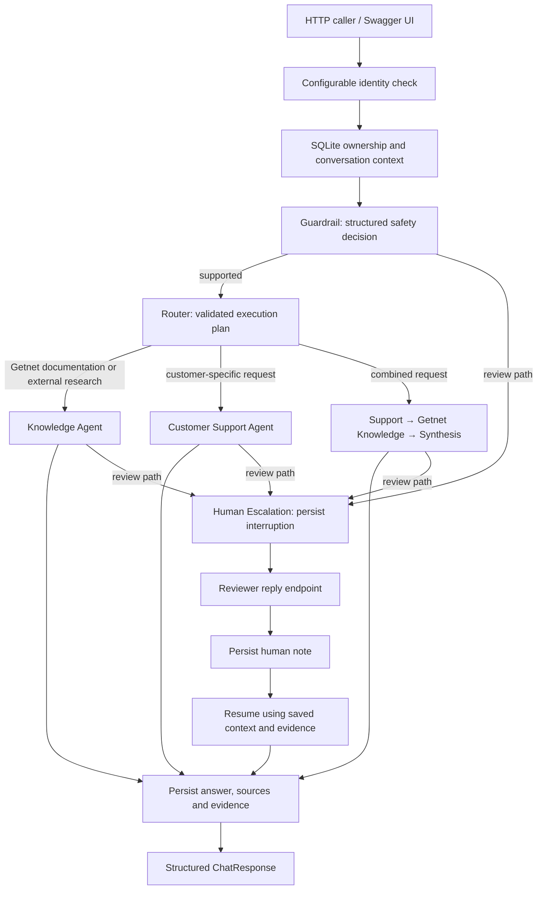

# AI Hardcore Engineer — Getnet Multi-Agent Support

**Specialist intelligence, grounded answers and persistent conversations in one traceable support API.**

A Python 3.12 / FastAPI application that combines Gemini, official Getnet documentation,
live web research and customer-specific tools. Each request follows an explicit workflow:
validate the request, classify its safety, select specialists, retrieve evidence and
persist the outcome. Portuguese and English answers share the same orchestration,
conversation memory and source tracking.

| Delivery | Implemented scope |
| --- | --- |
| **239 passing deterministic tests** | API contracts, orchestration, memory, isolation, retrieval, tools and review workflows |
| **10 recorded conversations** | Complete requests and actual HTTP responses from the original challenge questions |
| **17 evaluation scenarios** | Original questions, customer profile, guardrails and mixed specialist requests |
| **4 agent roles** | Router, Knowledge, Customer Support and Human Escalation |
| **3 routing strategies** | Official Getnet RAG, external web research and customer-specific support |
| **2 customer tools** | Profile and activity records scoped to the requesting customer |

## Review the project without an API key

Start with the [recorded execution](#recorded-execution--all-ten-original-questions):
every response is included directly in this README, with the answer, executed agents,
tools, sources, request ID and conversation state. The recording covers product
comparison, weather, settlement dates, Pix, connectivity, receivables advance, exchange
rates, transaction declines, crediário and Payment Link.

Then inspect the [architecture](#architecture), the [engineering decisions](#engineering-decisions)
and the [verification strategy](#verification-and-evaluation). The deterministic suite
runs with external services mocked and credentials cleared:

```bash
docker compose build
docker compose run --rm --no-deps -e GEMINI_API_KEY= api python -m pytest -q
```

Latest deterministic validation: **239 passed**. These tests exercise the application
code through controlled provider, search and ingestion boundaries.

## What makes the system stand out

| Capability | Implementation | Practical value |
| --- | --- | --- |
| **Evidence-aware answers** | Separate public RAG, web retrieval and customer-data paths | Each question uses an appropriate information source |
| **Typed agent decisions** | Pydantic schemas validate safety classifications, plans, tool choices and knowledge answers | Model decisions become explicit application contracts |
| **Bounded specialist collaboration** | A validated plan runs one specialist or Support → Getnet Knowledge → Synthesis | Customer records and public guidance can form one coherent response |
| **Bilingual retrieval** | English search terms expand into Portuguese Getnet terms; generation follows the user's language | English questions can use official Brazilian product documentation |
| **Full-page web evidence** | Five search results, three concurrent downloads, page text and location/date metadata | Weather and currency answers receive the values behind the search snippets |
| **Persistent human review** | SQLite stores interruption state, evidence and reviewer notes before resuming | Conversations retain context across container recreation |
| **Conversation ownership** | User-scoped records, credential mapping and atomic turn claims | Context and tool access follow a concrete customer identity |
| **Inspectable operations** | Request IDs, structured events, returned tools and source URLs | Reviewers can follow the executed path from HTTP request to answer |

## Architecture



The Router selects the execution path. The Knowledge Agent retrieves public evidence.
The Customer Support Agent selects customer tools. The Human Escalation Agent creates
an explicit review state that the conversation store persists.

A mixed plan runs `customer_support` followed by `knowledge_getnet`, then synthesizes
the specialist outputs. The second specialist receives the first answer and its
sources; synthesis preserves source URLs, record dates and the synthetic-data context.
The plan contains at most two specialist steps, validates their order and prevents
repeated specialists.

### Information paths

| Route | Evidence pipeline | Main implementation |
| --- | --- | --- |
| `knowledge_getnet` | Official Getnet HTML → extracted text → chunks → TF-IDF/cosine retrieval → grounded generation | [knowledge.py](app/agents/knowledge.py), [ingest.py](app/rag/ingest.py), [retriever.py](app/rag/retriever.py) |
| `knowledge_web` | DuckDuckGo results → bounded page downloads → extracted page content and metadata → grounded generation | [web_search.py](app/tools/web_search.py), [web_pages.py](app/tools/web_pages.py) |
| `customer_support` | Validated tool selection → customer-scoped JSON records → contextual answer | [customer_support.py](app/agents/customer_support.py), [customer_data.py](app/tools/customer_data.py) |
| Human review | Persisted request, phase, plan, completed steps and evidence → reviewer note → resumed answer | [conversations.py](app/conversations.py), [router.py](app/agents/router.py) |

## Engineering decisions

### Explicit orchestration and a single provider boundary

Agent control flow is implemented directly in Python. All model calls pass through
[Gemini](app/services/gemini.py), including safety classification, execution planning,
tool selection, answer generation, synthesis, human-review resumption and optional
answer judging. Provider configuration, timeouts and error translation have one
integration point.

[Typed schemas](app/schemas.py) define the model/application boundary. The application
validates structured JSON before executing a plan or selecting tools. Operational
state captures the selected plan, phase, completed steps and retrieved evidence.

### Getnet RAG tuned to the product domain

The ingestion pipeline starts from official product, service and FAQ URLs and collects
up to 12 pages by default, configurable up to 20. BeautifulSoup extracts HTML content
and literal FAQ/technical-sheet widget fields.

Text is split into **180-word chunks with 30-word overlap**. TF-IDF and cosine
similarity rank the local corpus and return up to four chunks for generation. English
query expansion connects terms such as product features and receivables advance to
Portuguese documentation. Product comparisons preserve sources for both named
terminals, while the agent prioritizes specific product documentation.

The JSON corpus keeps the evidence inspectable. Ingestion writes a temporary file
before replacing the active corpus, preserving a usable index throughout refreshes.

### Web research that reads the evidence

The external knowledge path retrieves up to **five valid search results** and reads
their pages with **three concurrent workers**. Per-page controls include a six-second
retrieval budget, three redirects, a 750 KB download ceiling and 12,000 characters of
extracted text.

Extraction preserves page text, image descriptions, headings, location breadcrumbs,
coordinates and available publication metadata. A separate timestamp records retrieval
time. The Knowledge Agent receives calendar dates and weekdays calculated in
`America/Sao_Paulo`, with explicit instructions to associate forecast values with the
requested day and location.

Each destination is resolved and validated before connecting. Connections pin the
validated public IP while retaining the original hostname for TLS verification.
Redirect targets receive the same validation. Parallel enrichment uses the existing
HTTP and HTML dependencies and adds **zero model calls** to the answer workflow.

### Persistent memory with controlled context

[ConversationStore](app/conversations.py) persists user/assistant messages, human notes,
evidence and handoff state in SQLite. Conversation UUIDs are associated with the
requesting `user_id`.

The prompt receives the most recent **12 messages**, capped at **12,000 characters**,
with both values configurable. Recent user messages also inform retrieval, allowing
follow-ups such as “É a Smart” to refer to the earlier device discussion.

Short SQLite transactions claim a conversation before execution and release it after
the turn. Claims expire after ten minutes, and commit checks verify the active claim.
Network and model calls run outside database transactions. This keeps state ownership
explicit while the specialists retrieve and generate.

### Customer tools with an explicit data contract

`get_customer_profile` and `get_customer_activity` expose read-only customer records
from [customers.json](data/customers.json). The HTTP request's authorized `user_id`
selects the customer record; tool selection operates within that scope.

The included `cliente1988` fixture has a **2026-10-15 snapshot**, with synthetic profile,
terminal, sales and settlement records. This provides a reproducible customer scenario.
Public RAG and web evidence retain their collected source URLs. The response field
`data_mode: "synthetic"` identifies the customer-data fixture.

### Human review as a persisted workflow

Review creates an `awaiting_human` response with `requires_human`, `handoff_id` and
`conversation_id`. The saved state includes the original request, interruption phase,
validated plan, completed steps and available evidence.

A reviewer posts a note to `POST /handoffs/{handoff_id}/reply`. The application persists
the note before generation, resumes from the saved evidence and records the final
answer. Pending handoffs survive process/container recreation; note handling preserves
retry consistency. Other conversations can continue while one awaits review.

### Identity and observability integrated into the API

Configurable demo credentials map `X-API-Key` to the requesting customer and use a
separate `X-Reviewer-Key` for review. Credential comparisons use UTF-8 bytes and
`compare_digest`. Ownership checks return a consistent `404` for inaccessible
conversation IDs, and overlapping conversation turns return `409`.

Structured logs record operational events with a correlated `request_id`. Retrieved
evidence is persisted internally for review and evaluation; public responses expose
the answer, source URLs and executed tools/agents. Logging selects operational
metadata, keeping messages, customer records and credentials out of log payloads.
Prompts explicitly mark questions, history, pages, tool results and reviewer notes as
untrusted data.

## Recorded execution — all ten original questions

The following conversations were captured on **October 29, 2026** and supplied from
an actual API execution. The full response payloads are reproduced below, preserving
their original answers, IDs, sources, HTTP status and review states. Dates and numeric
values belong to that recorded execution.

Every request in this recording uses `user_id: "cliente1988"` and creates a new
conversation by omitting `conversation_id`. Expand a scenario to inspect its complete
request and response. The records expose both automatic answers and persisted
handoffs through the same API contract.

| # | Scenario | Executed tool | Recorded state |
| --- | --- | --- | --- |
| 1 | Official product comparison | `getnet_rag` | `answered` |
| 2 | Weather with date and location | `web_search` | `answered` |
| 3 | Customer settlement schedule | `get_customer_activity` | `answered` |
| 4 | Pix requirements and persisted review | `getnet_rag` | `awaiting_human` |
| 5 | Customer terminal connectivity | `get_customer_activity` | `answered` |
| 6 | Receivables advance | `getnet_rag` | `answered` |
| 7 | Dated exchange-rate answer | `web_search` | `answered` |
| 8 | Operational handoff persistence | — | `awaiting_human` |
| 9 | Crediário installment conditions | `getnet_rag` | `answered` |
| 10 | WhatsApp and Payment Link | `getnet_rag` | `answered` |

<details>
<summary><strong>1. What's the difference between the Get Clássica and the Get Smart?</strong></summary>

Official product comparison.

**Request — `POST /chat`**

```json
{
  "message": "What's the difference between the Get Clássica and the Get Smart?",
  "user_id": "cliente1988"
}
```

**Recorded response — HTTP 200**

```json
{
  "answer": "The Get Clássica features up to 12 hours of battery life and a physical keypad (https://site.getnet.com.br/maquininha/get-classica/). In contrast, the Get Smart features a long-lasting battery and a touch keyboard (https://site.getnet.com.br/maquininha/get-smart/), and it is an intelligent card machine that allows you to control inventory, place orders, close bills, issue invoices, and integrate theterminal with your establishment's system directly on the machine (https://site.getnet.com.br/maquininha/get-smart/).",
  "agents_used": [
    "router",
    "knowledge"
  ],
  "tools_used": [
    "getnet_rag"
  ],
  "sources": [
    "https://site.getnet.com.br/maquininha/get-classica/",
    "https://site.getnet.com.br/maquininha/get-smart/"
  ],
  "request_id": "7a05ac30-d284-44cc-a971-879a7449b9ac",
  "route": "knowledge_getnet",
  "guardrail_category": "supported",
  "status": "answered",
  "conversation_id": "131430ed-abb1-4065-9e3f-1a4fab0baa39",
  "requires_human": false,
  "data_mode": "synthetic"
}
```

</details>

<details>
<summary><strong>2. What's the weather forecast in Porto Alegre tomorrow?</strong></summary>

Weather with date and location.

**Request — `POST /chat`**

```json
{
  "message": "What's the weather forecast in Porto Alegre tomorrow?",
  "user_id": "cliente1988"
}
```

**Recorded response — HTTP 200**

```json
{
  "answer": "For tomorrow, Friday, October 30, 2026, the weather forecast for Porto Alegre is mostly cloudy with occasional rain, with a high of 23 °C and a low of 17 °C, and winds at around 20 km/h (https://www.meteoblue.com/en/weather/week/porto-alegre_brazil_3452925).",
  "agents_used": [
    "router",
    "knowledge"
  ],
  "tools_used": [
    "web_search"
  ],
  "sources": [
    "https://www.easeweather.com/south-america/brazil/rio-grande-do-sul/porto-alegre/tomorrow",
    "https://www.meteoblue.com/en/weather/week/porto-alegre_brazil_3391406?day=3",
    "https://www.weather-atlas.com/en/brazil/porto-alegre-weather-tomorrow",
    "https://www.weather-forecast.com/locations/Porto-Alegre/forecasts/latest",
    "https://www.meteoblue.com/en/weather/week/porto-alegre_brazil_3452925"
  ],
  "request_id": "e6fcafdf-7082-4d73-9e16-fc6ef5578f7d",
  "route": "knowledge_web",
  "guardrail_category": "supported",
  "status": "answered",
  "conversation_id": "68c67eee-ebe3-4e2a-8745-c084a21506ed",
  "requires_human": false,
  "data_mode": "synthetic"
}
```

</details>

<details>
<summary><strong>3. When will the money from yesterday's sales be deposited?</strong></summary>

Customer settlement schedule.

**Request — `POST /chat`**

```json
{
  "message": "When will the money from yesterday's sales be deposited?",
  "user_id": "cliente1988"
}
```

**Recorded response — HTTP 200**

```json
{
  "answer": "Please note that these records are fictional. \n\nBased on the snapshot data from October 15, 2026, the sales made on October 14, 2026 (referred to in your question) have the following expected deposit dates according to the system records:\n\n* **Sale ID demo-sale-001** (debit, net amount: 147.75BRL): The expected deposit date is **2026-10-15** (status: scheduled).\n* **Sale ID demo-sale-002** (credit, net amount: 291.00 BRL): The expected deposit date is **2026-11-13** (status: scheduled).\n\nPlease note that I cannot perform actions on accounts or devices, and this information reflects the expected dates from the records without guaranteeing an actual transfer time.",
  "agents_used": [
    "router",
    "customer_support"
  ],
  "tools_used": [
    "get_customer_activity"
  ],
  "sources": [],
  "request_id": "ac56c6fe-a18a-4e55-b723-1c1f439b71ed",
  "route": "customer_support",
  "guardrail_category": "supported",
  "status": "answered",
  "conversation_id": "56f25925-e4e6-4e2c-9912-8df66d143cab",
  "requires_human": false,
  "data_mode": "synthetic"
}
```

</details>

<details>
<summary><strong>4. Do I need a bank account to receive my sales via Pix?</strong></summary>

Pix requirements and persisted review.

**Request — `POST /chat`**

```json
{
  "message": "Do I need a bank account to receive my sales via Pix?",
  "user_id": "cliente1988"
}
```

**Recorded response — HTTP 200**

```json
{
  "answer": "I could not safely resolve this request. The conversation is awaiting local human review. No external support agent has been contacted.",
  "agents_used": [
    "router",
    "knowledge",
    "human_escalation"
  ],
  "tools_used": [
    "getnet_rag"
  ],
  "sources": [
    "https://site.getnet.com.br/duvidas/",
    "https://site.getnet.com.br/get-ajuda-get-conta/o-que-e-a-get-conta/",
    "https://site.getnet.com.br/pix/"
  ],
  "request_id": "570414ef-b11d-4938-bdcf-961bdf20327f",
  "route": "knowledge_getnet",
  "guardrail_category": "supported",
  "status": "awaiting_human",
  "escalation_reason": "insufficient_information",
  "conversation_id": "e08d5740-ae1d-4e0e-8a3e-f3fdff41e642",
  "requires_human": true,
  "handoff_id": "45bca8ca-9c51-4d8f-9ab3-9753339a9263",
  "data_mode": "synthetic"
}
```

</details>

<details>
<summary><strong>5. My card machine won't connect to the internet, what should I do?</strong></summary>

Customer terminal connectivity.

**Request — `POST /chat`**

```json
{
  "message": "My card machine won't connect to the internet, what should I do?",
  "user_id": "cliente1988"
}
```

**Recorded response — HTTP 200**

```json
{
  "answer": "Please note that these records are fictional. \n\nRegarding your card machine (`demo-device-1988`, model: Get Smart), the tool data shows that the device status is currently **offline**, last seen on **2026-10-14 at 18:00:00-03:00**. The recorded connection type is **Wi-Fi**, and the last connection error is **\"Wi-Fi network unavailable\"**. \n\nPlease ensure your Wi-Fi network is working properly and that the card machine is within range and connected to the correct network. Note that I cannot perform actions on your device or account.\n\nAdditionally, based on your activity records (snapshot date: 2026-10-15), here are the expected deposit dates for your approved sales:\n- **2026-10-15:** Scheduled deposit of **147.75 BRL** (from sale `demo-sale-001`).\n- **2026-11-13:** Scheduled deposit of **291.00 BRL** (from sale `demo-sale-002`).\n\nPlease note that these are the expected dates from the records, and Icannot promise an actual transfer. No device diagnostics or transaction details beyond what is providedhere are available in the system.",
  "agents_used": [
    "router",
    "customer_support"
  ],
  "tools_used": [
    "get_customer_activity"
  ],
  "sources": [],
  "request_id": "ba1d6184-60cf-4c7f-a931-0bc6eb039450",
  "route": "customer_support",
  "guardrail_category": "supported",
  "status": "answered",
  "conversation_id": "f40d4013-bda8-426a-a6cc-2cf1568f7a1e",
  "requires_human": false,
  "data_mode": "synthetic"
}
```

</details>

<details>
<summary><strong>6. How does receivables advance (antecipação) work with Getnet?</strong></summary>

Receivables advance.

**Request — `POST /chat`**

```json
{
  "message": "How does receivables advance (antecipação) work with Getnet?",
  "user_id": "cliente1988"
}
```

**Recorded response — HTTP 200**

```json
{
  "answer": "Receivables advance (antecipação de recebíveis) with Getnet allows entrepreneurs to receive the money from credit card sales—whether made in cash or in installments—before the original compensation deadline. By paying a fee charged by the financial institution or operator, the merchant can access funds early instead of waiting for the scheduled future dates. Additionally, sales can be anticipated simply through the Getnet Brasil app, and automated advance conditions are also available depending on thechosen receipt plan. Sources: https://site.getnet.com.br/quando-vale-a-pena-antecipar-as-suas-vendas-no-cartao/, https://site.getnet.com.br/duvidas/",
  "agents_used": [
    "router",
    "knowledge"
  ],
  "tools_used": [
    "getnet_rag"
  ],
  "sources": [
    "https://site.getnet.com.br/quando-vale-a-pena-antecipar-as-suas-vendas-no-cartao/",
    "https://site.getnet.com.br/duvidas/"
  ],
  "request_id": "40cb9480-beb8-4dae-b76e-13739edfbf03",
  "route": "knowledge_getnet",
  "guardrail_category": "supported",
  "status": "answered",
  "conversation_id": "5fb21bbe-462f-4155-a471-91ce0c73707c",
  "requires_human": false,
  "data_mode": "synthetic"
}
```

</details>

<details>
<summary><strong>7. What's the euro exchange rate today?</strong></summary>

Dated exchange-rate answer.

**Request — `POST /chat`**

```json
{
  "message": "What's the euro exchange rate today?",
  "user_id": "cliente1988"
}
```

**Recorded response — HTTP 200**

```json
{
  "answer": "The live euro exchange rate today is 1.1146 USD per 1 EUR (or 1 USD = 0.8971 EUR), with a live bid of 1.11464 and an ask of 1.11472 as of October 29, 2026. Source: https://www.live-rates.com/rates/eur-usd",
  "agents_used": [
    "router",
    "knowledge"
  ],
  "tools_used": [
    "web_search"
  ],
  "sources": [
    "https://www.live-rates.com/rates/eur-usd",
    "https://exchangerates.com/currencies/eur/",
    "https://xrates.org/usd-to-eur",
    "https://wise.com/us/currency-converter/live-exchange-rates",
    "https://www.xe.com/currencyconverter/"
  ],
  "request_id": "0347498c-1479-4187-9c31-4345a569482b",
  "route": "knowledge_web",
  "guardrail_category": "supported",
  "status": "answered",
  "conversation_id": "00fbb3db-053f-4b1f-8cf8-919591b5a37f",
  "requires_human": false,
  "data_mode": "synthetic"
}
```

</details>

<details>
<summary><strong>8. My card machine is showing a transaction decline error.</strong></summary>

Operational handoff persistence.

**Request — `POST /chat`**

```json
{
  "message": "My card machine is showing a transaction decline error.",
  "user_id": "cliente1988"
}
```

**Recorded response — HTTP 200**

```json
{
  "answer": "I could not safely resolve this request. The conversation is awaiting local human review. No external support agent has been contacted.",
  "agents_used": [
    "human_escalation"
  ],
  "tools_used": [],
  "sources": [],
  "request_id": "c78bb3d4-e9d4-4aab-ac26-c245e00a2ec7",
  "status": "awaiting_human",
  "escalation_reason": "internal_error",
  "conversation_id": "65d7d6ec-6846-4e5e-af38-c1d003f5068c",
  "requires_human": true,
  "handoff_id": "c0739656-fe8a-49e6-9aca-e083a566b7ee",
  "data_mode": "synthetic"
}
```

</details>

<details>
<summary><strong>9. How many installments can I split a sale into with the crediário?</strong></summary>

Crediário installment conditions.

**Request — `POST /chat`**

```json
{
  "message": "How many installments can I split a sale into with the crediário?",
  "user_id": "cliente1988"
}
```

**Recorded response — HTTP 200**

```json
{
  "answer": "You can split a sale into up to 48 installments using the crediário. Relevant condition: The maximum installment term and interest rates vary according to the card issuer's credit policies (https://site.getnet.com.br/crediario/, https://site.getnet.com.br/duvidas/).",
  "agents_used": [
    "router",
    "knowledge"
  ],
  "tools_used": [
    "getnet_rag"
  ],
  "sources": [
    "https://site.getnet.com.br/duvidas/",
    "https://site.getnet.com.br/crediario/"
  ],
  "request_id": "4225fb69-a1f0-41c3-a991-bf90b7b0f4da",
  "route": "knowledge_getnet",
  "guardrail_category": "supported",
  "status": "answered",
  "conversation_id": "9de07b65-dde5-4765-8b8c-2929df65da48",
  "requires_human": false,
  "data_mode": "synthetic"
}
```

</details>

<details>
<summary><strong>10. Can I sell through WhatsApp using the Payment Link?</strong></summary>

WhatsApp and Payment Link.

**Request — `POST /chat`**

```json
{
  "message": "Can I sell through WhatsApp using the Payment Link?",
  "user_id": "cliente1988"
}
```

**Recorded response — HTTP 200**

```json
{
  "answer": "Yes, you can sell through WhatsApp using the Payment Link solution. It is ideal for sales via WhatsApp, social media, remote billing, or for those who do not have their own website, allowing youto create, send, and receive payments with practicality and security (https://site.getnet.com.br/link-de-pagamento/).",
  "agents_used": [
    "router",
    "knowledge"
  ],
  "tools_used": [
    "getnet_rag"
  ],
  "sources": [
    "https://site.getnet.com.br/link-de-pagamento/",
    "https://site.getnet.com.br/duvidas/"
  ],
  "request_id": "d601155e-ebe8-4e1f-b557-23cb64ae07e6",
  "route": "knowledge_getnet",
  "guardrail_category": "supported",
  "status": "answered",
  "conversation_id": "6fcc6c0b-8fcc-4ba4-ae7f-e5dcba1be4f3",
  "requires_human": false,
  "data_mode": "synthetic"
}
```

</details>

## Run the application

### Docker Compose

Create the environment file while preserving an existing configuration:

```bash
cp -n .env.example .env
```

Set `GEMINI_API_KEY` in `.env` for live model execution. `GEMINI_MODEL` selects the
provider model; the available settings are documented in [.env.example](.env.example).

```bash
docker compose config --quiet
docker compose up --build -d --force-recreate
docker compose exec -T api python -m app.rag.ingest
curl -fsS http://localhost:8000/health
curl -fsS http://localhost:8000/ready
```

Open **http://localhost:8000/docs** for the interactive API.

The Compose volume `./data:/app/data` persists the RAG corpus and SQLite conversations
across container recreation. Environment credentials and generated database files
are excluded from the image build context and Git tracking.

### Local Python

```bash
python3.12 -m venv .venv
.venv/bin/python -m pip install -r requirements.txt
cp -n .env.example .env
# Set GEMINI_API_KEY in .env for live model execution.
.venv/bin/python -m app.rag.ingest
.venv/bin/python -m uvicorn app.main:app --host 0.0.0.0 --port 8000
```

### Configuration

| Variable | Purpose | Default |
| --- | --- | --- |
| `GEMINI_API_KEY` | Live Gemini credential | Supplied through the environment |
| `GEMINI_MODEL` | Gemini model identifier | `gemini-flash-latest` |
| `GEMINI_TIMEOUT_SECONDS` | Model-call timeout | `30` |
| `HTTP_TIMEOUT_SECONDS` | Search/ingestion HTTP timeout | `15` |
| `DATA_DIR` | Corpus, customer records and conversation storage | Project `data/` |
| `HISTORY_MAX_MESSAGES` | Recent messages supplied to agents | `12` |
| `HISTORY_MAX_CHARS` | Conversation prompt character budget | `12000` |
| `DEMO_API_KEYS` | JSON credential-to-customer mapping | `{}` |
| `REVIEWER_API_KEY` | Separate local reviewer credential | Configured with identity mapping |

## Exercise the workflows manually

### Public knowledge and web research

```bash
curl -sS http://localhost:8000/chat -H 'Content-Type: application/json' \
  -d '{"message":"Compare Get Clássica and Get Smart.","user_id":"cliente1988"}'

curl -sS http://localhost:8000/chat -H 'Content-Type: application/json' \
  -d '{"message":"Qual é a previsão do tempo em Porto Alegre, RS, amanhã?","user_id":"cliente1988"}'
```

Inspect `answer`, `route`, `agents_used`, `tools_used`, `sources` and
`request_id`. Check the cited page against the named product, forecast date,
location and units. The original ten questions are reproduced in the recording above.

### Persistent conversation memory

```bash
curl -sS http://localhost:8000/chat -H 'Content-Type: application/json' \
  -d '{"message":"Minha maquininha não conecta na internet.","user_id":"cliente1988"}'

# Copy conversation_id from the response.
CONVERSATION_ID='<returned UUID>'
curl -sS http://localhost:8000/chat -H 'Content-Type: application/json' \
  -d "{\"message\":\"É a Smart.\",\"user_id\":\"cliente1988\",\"conversation_id\":\"$CONVERSATION_ID\"}"
```

Check that the second turn reuses the conversation ID and understands the device
reference. Recreate the container and continue with the same ID to exercise persistence.

### Customer tools and specialist collaboration

```bash
# Customer profile: receiving configuration.
curl -sS http://localhost:8000/chat -H 'Content-Type: application/json' \
  -d '{"message":"What is my receiving configuration?","user_id":"cliente1988"}'

# Customer activity: recorded sales and settlement dates.
curl -sS http://localhost:8000/chat -H 'Content-Type: application/json' \
  -d '{"message":"When are my recorded sales scheduled for deposit?","user_id":"cliente1988"}'

# Mixed plan: customer records plus official product documentation.
curl -sS http://localhost:8000/chat -H 'Content-Type: application/json' \
  -d '{"message":"Check my terminal model and connection status, then compare Get Smart and Get Clássica using official product documentation.","user_id":"cliente1988"}'
```

Check `get_customer_profile` and `get_customer_activity` on the respective customer
requests. On the mixed request, inspect the recorded `customer_support`, `knowledge`
and `synthesis` agents, both tools and the official product source URLs.

### Human interrupt and resume

```bash
curl -sS http://localhost:8000/chat -H 'Content-Type: application/json' \
  -d '{"message":"Quero atendimento humano.","user_id":"cliente1988"}'

# Copy handoff_id from the response; conversation_id identifies the saved conversation.
HANDOFF_ID='<returned UUID>'
docker compose up -d --force-recreate

curl -sS "http://localhost:8000/handoffs/$HANDOFF_ID/reply" \
  -H 'Content-Type: application/json' \
  -d '{"response":"O registro fictício indica Get Smart offline no Wi-Fi. Oriente verificar a disponibilidade da rede."}'
```

Inspect `awaiting_human`, the generated handoff ID and the resumed `answered`
response. The final result retains the original conversation ID and adds
`human_resume` to the executed agents.

### Configurable demo identity

Configure customer and reviewer credentials in `.env`:

```dotenv
DEMO_API_KEYS={"<customer-key>":"cliente1988","<second-customer-key>":"synthetic-user-b"}
REVIEWER_API_KEY=<separate-reviewer-key>
```

Recreate the API after configuration. Add `X-API-Key` to chat requests and
`X-Reviewer-Key` to reviewer replies. Check authorized access, a customer/identity
mismatch (`403`), an invalid credential (`401`) and cross-customer conversation
access (`404`).

## Verification and evaluation

The project combines deterministic regression checks, live workflow smoke tests,
declarative evaluation cases and evidence-based model judging.

| Layer | What it exercises | Entry point |
| --- | --- | --- |
| Deterministic tests | API/schema validation, routing, tools, isolation, history, atomic claims, review persistence, RAG and public-page retrieval | [tests/](tests/) |
| Live smoke | Health, readiness, first turn, continuation, mixed specialists, human interrupt and resume | [evals/smoke.py](evals/smoke.py) |
| Scenario evaluation | Expected route, agents, tools, guardrail, status, source URLs, language and answer concepts | [evals/cases.json](evals/cases.json), [evals/run.py](evals/run.py) |
| Evidence-based judging | Groundedness, relevance, correctness and unsupported-claim checks against persisted evidence | [evals/quality.py](evals/quality.py) |

```bash
# Credential-free deterministic suite.
docker compose run --rm --no-deps -e GEMINI_API_KEY= api python -m pytest -q

# Live workflow smoke using the configured Gemini provider.
docker compose exec -T api python -m evals.smoke

# Seventeen declarative scenarios with spaced execution.
docker compose exec -T api python -m evals.run --delay 20

# Gemini judging against the API's persisted evidence.
docker compose exec -T api python -m evals.run --judge --delay 20
```

The **17 scenarios** include the original ten questions, customer profile, four
guardrail cases and two mixed requests. Each declares its expected operational path
and answer constraints. The smoke runner records all seven stages.

The optional Gemini judge uses the question, answer, actual persisted evidence and
case constraints. It returns structured **1–5** scores for groundedness, relevance
and correctness, together with unsupported-claim findings. Passing requires all three
scores to be at least four and an empty unsupported-claims list.

Run judging in the API container so it reads the same conversation database. With
demo identity configured, set `EVAL_API_KEY` to the evaluation customer's credential.
The evaluation CLI returns `0` for a passing run, `1` for a failing run and `2`
for invalid configuration.

## API and operational visibility

| Endpoint | Contract |
| --- | --- |
| `POST /chat` | Validated message, customer ID and optional conversation ID; returns the answer and execution metadata |
| `POST /handoffs/{handoff_id}/reply` | Persists a reviewer note and resumes the saved conversation |
| `GET /health` | Process liveness |
| `GET /ready` | Checks SQLite access, the local RAG index and configured Gemini credentials |
| `GET /docs` | Interactive OpenAPI documentation |

`ChatResponse` exposes `answer`, `agents_used`, `tools_used`, `sources`,
`request_id`, `route`, `guardrail_category`, `status`, `escalation_reason`,
`conversation_id`, `requires_human`, `handoff_id` and `data_mode`.

The `X-Request-ID` response header correlates the HTTP exchange with structured logs.
Web retrieval logs include both result count and `pages_loaded`, making search and
page enrichment separately visible.

```bash
docker compose logs --tail 100 api
```

## Repository guide

| Path | Responsibility |
| --- | --- |
| [app/main.py](app/main.py) | FastAPI endpoints and dependency wiring |
| [app/schemas.py](app/schemas.py) | HTTP, agent and tool contracts |
| [app/agents/](app/agents/) | Routing, public knowledge, customer support and human escalation |
| [app/guardrails/](app/guardrails/) | Structured request-safety classification |
| [app/services/gemini.py](app/services/gemini.py) | Centralized model-provider integration |
| [app/rag/](app/rag/) | Official-source ingestion and local retrieval |
| [app/tools/](app/tools/) | Customer data, web search and public-page enrichment |
| [app/conversations.py](app/conversations.py) | Durable messages, evidence, turn claims and review state |
| [app/identity.py](app/identity.py) | Customer and reviewer credential checks |
| [data/customers.json](data/customers.json) | Reproducible synthetic customer fixture |
| [evals/](evals/) | Scenario catalog, smoke runner and answer-quality evaluation |
| [tests/](tests/) | Deterministic regression suite |
| [docker-compose.yml](docker-compose.yml) | Local API runtime and persistent data volume |


