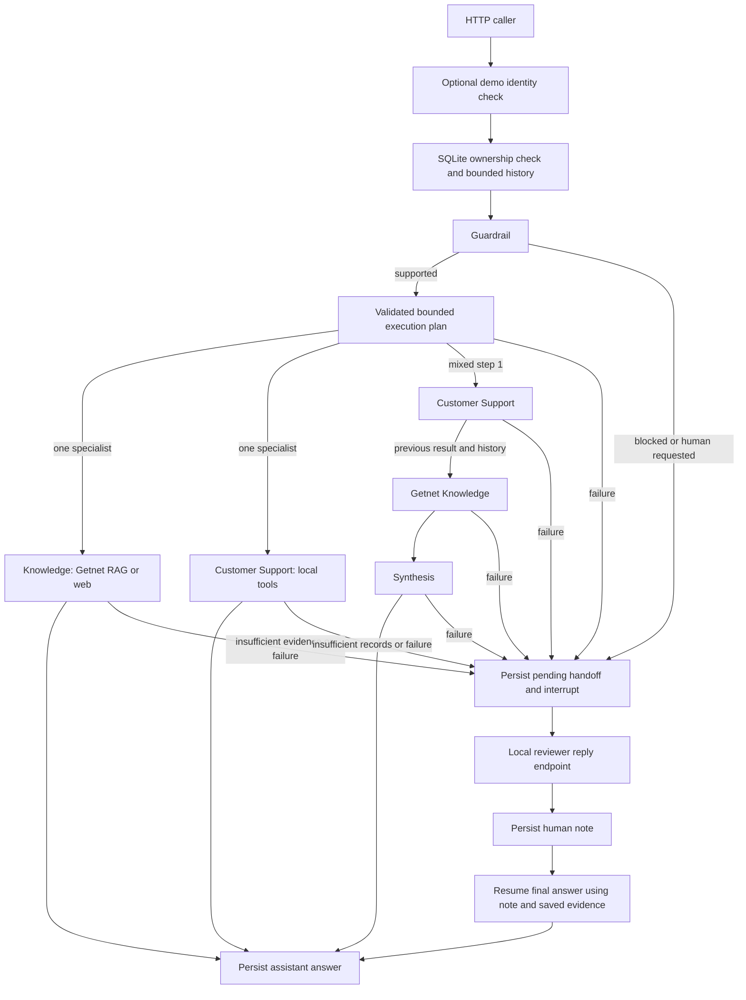

# AI Hardcore Engineer — Multi-Agent Support System

Python 3.12 / FastAPI support API with Gemini, local Getnet RAG, synthetic customer tools,
SQLite conversation memory and local human review. No external database or agent framework.
User answers support Portuguese and English. This is a technical challenge demonstration.

## Setup and Docker

Create `.env` only if it does not exist, then configure an available Gemini model and key:

```bash
cp -n .env.example .env
docker compose config --quiet
docker compose up --build -d --force-recreate
docker compose exec api python -m app.rag.ingest
curl -fsS http://localhost:8000/health
curl -fsS http://localhost:8000/ready
```

The existing `./data:/app/data` volume persists `data/rag/chunks.json` and
`data/conversations.db` across container recreation. Do not commit either generated file.
`.env` and SQLite files are excluded from the image build context. Never commit real keys.
See `/docs` for the validated request/response schemas.

For local Python: create a virtual environment, install `requirements.txt`, run
`python -m app.rag.ingest`, then `uvicorn app.main:app --host 0.0.0.0 --port 8000`.

## Architecture



All provider calls, including optional judging, use `app/services/gemini.py`.
Guardrail decisions, execution plans and tool selection use Pydantic JSON validation.
Invalid routing fails closed into a persisted handoff. No private model reasoning is
requested, returned or persisted.

## Memory and isolation

`POST /chat` still requires `message` and `user_id`. `conversation_id` is optional:

- Omit it to create a UUID conversation associated with the supplied user.
- Reuse it for a continuation. Missing and foreign conversations both return `404`.
- User and assistant messages, human notes, operational metadata and retrieved/tool
  evidence are persisted in SQLite. Evidence is excluded from HTTP responses.
- Router, guardrail and specialists receive the last 12 messages, capped at 12,000
  characters. Configure `HISTORY_MAX_MESSAGES` and `HISTORY_MAX_CHARS` in the environment.
  The current message is supplied separately. Retrieval includes recent user messages
  so short follow-ups such as “É a Smart” can refer to an earlier connection problem.
- SQLite transactions claim a conversation while a turn runs. Overlapping requests
  return `409`. Claims expire after ten minutes after a crashed worker; a replaced
  worker cannot commit its old result. Network calls never hold SQLite transactions.

History is bounded for prompts; stored records are retained until removed by the local
operator. Storage is local plaintext and requires appropriate host access controls.

## Bounded orchestration and RAG

The plan contains `agents` and `needs_synthesis`. Valid plans are one of
`knowledge_getnet`, `knowledge_web`, `customer_support`, or the two-step sequence
`customer_support` → `knowledge_getnet` with synthesis. Plans cannot repeat specialists,
exceed two steps or replan. A specialist interruption stops the remaining execution.
The next specialist receives the earlier answer and sources; synthesis merges the
answers, preserving uncertainty, synthetic-data disclaimers and source URLs.
The public `route` remains the first route for compatibility; `agents_used` records
all executed agents, including `synthesis` for a mixed request.

RAG remains **HTML → BeautifulSoup → 180-word chunks / 30-word overlap → TF-IDF /
cosine similarity → up to four chunks → Gemini**. Ingestion attempts up to 12 Getnet
URLs (configurable up to 20), including Brazilian product pages and global pages.
It extracts literal FAQ/technical-sheet widget text without executing JavaScript,
expands common English search terms into Portuguese and preserves both product
sources in comparisons. A total ingestion failure preserves the previous corpus.
External questions retain DuckDuckGo snippet search. Retrieved text, tool results,
history and human notes are explicitly treated as untrusted data in prompts.

Customer tools read `data/customers.json`, using the HTTP `user_id` directly; the LLM
cannot select another customer. `cliente1988` contains fictional records with a fixed
snapshot dated 2026-10-15. Tools never perform account, payment or device mutations.

## Real local human review

Guardrail blocks, explicit requests for human support, insufficient context and provider
failures create a local handoff. The response has `status=awaiting_human`,
`requires_human=true`, `handoff_id` and `conversation_id`. Further chat turns in that
conversation return `409` until review completes. Other conversations can continue.

`POST /handoffs/{handoff_id}/reply` accepts `{"response":"..."}` and an optional
`user_id` ownership assertion. A reviewer can supply a note after restarting the app:
the pending request, interruption phase, validated plan/completed step count and
available tool/retrieval evidence are stored. The note is persisted **before** Gemini
resumes finalization. On success the final answer is saved and the handoff becomes
`resolved`; further replies return `409`. Unknown/foreign handoffs return `404`.
After a generation failure it remains pending; retry the same note without duplicating
the human message. Reviewer notes do not authorize unsafe actions or other-user access.

Resume runs a bounded final-answer step with the saved evidence and human note; it
does not restart completed tools, replan or run the interrupted remaining specialists.
This is an actual local interrupt/resume workflow. No external operator is contacted,
and no Slack, email or third-party ticket integration exists.

## HTTP examples

These examples use the default local demo mode. With demo authentication enabled, add
`-H "X-API-Key: $DEMO_KEY"` to chat and `-H "X-Reviewer-Key: $REVIEW_KEY"` to human replies.
Copy the actual IDs returned by the API into `CONVERSATION_ID` and `HANDOFF_ID`.

```bash
# First turn: save conversation_id from the response.
curl -sS http://localhost:8000/chat -H 'Content-Type: application/json' \
  -d '{"message":"Minha maquininha não conecta na internet.","user_id":"cliente1988"}'

# Reuse that conversation_id.
CONVERSATION_ID='<returned UUID>'
curl -sS http://localhost:8000/chat -H 'Content-Type: application/json' \
  -d "{\"message\":\"É a Smart.\",\"user_id\":\"cliente1988\",\"conversation_id\":\"$CONVERSATION_ID\"}"

# Customer-specific records plus public troubleshooting knowledge.
curl -sS http://localhost:8000/chat -H 'Content-Type: application/json' \
  -d '{"message":"My Smart terminal is offline. Check my terminal information and tell me how to fix the connection.","user_id":"cliente1988"}'

# Interrupt; save handoff_id and conversation_id.
curl -sS http://localhost:8000/chat -H 'Content-Type: application/json' \
  -d '{"message":"Quero atendimento humano.","user_id":"cliente1988"}'

# Local reviewer reply and resume.
HANDOFF_ID='<returned UUID>'
curl -sS "http://localhost:8000/handoffs/$HANDOFF_ID/reply" -H 'Content-Type: application/json' \
  -d '{"response":"O registro fictício indica Get Smart offline no Wi-Fi. Oriente verificar a rede; nenhum ajuste remoto foi realizado."}'
```

## Identity boundary

Default mode is an **unauthenticated local demo**. Ownership checks enforce supplied
`user_id` isolation but do not prove who the caller is. To demonstrate that additional
boundary, configure environment variables with your own synthetic credentials:

```dotenv
DEMO_API_KEYS={"<local-customer-key>":"cliente1988","<other-local-key>":"synthetic-user-b"}
REVIEWER_API_KEY=<separate-local-reviewer-key>
```

`X-API-Key` must match the supplied `user_id`: invalid/missing credentials return `401`,
and identity mismatch returns `403` before history or customer tools are accessed.
When the mapping is enabled, configuring a separate reviewer key is mandatory.
`X-Reviewer-Key` authorizes the reviewer endpoint; customer keys cannot perform reviews.
Reviewers intentionally have access across users. With no mapping/key configured the
review endpoint is open for local demonstration. This is not production authentication.

## Tests, live evaluation and answer quality

```bash
# Deterministic, no network, credentials or actual Gemini calls.
docker compose exec api python -m pytest -q

# Opt-in real HTTP/provider smoke: health, readiness, memory, mixed flow and HITL.
docker compose exec api python -m evals.smoke

# Live API evaluation: routing, tools, guardrails, sources and semantic constraints.
docker compose exec api python -m evals.run

# Explicitly opt-in Gemini judge using the API's persisted evidence.
docker compose exec api python -m evals.run --judge
```

`evals/cases.json` covers the original cases plus a mixed support/knowledge request.
Cases declare required tools/routes/agents/sources and optional required concept groups,
forbidden claim phrases, citation requirements and expected language. The deterministic
checks validate those constraints; language checking uses a documented word-marker
heuristic. These checks do not establish semantic correctness or entailment.

`--judge` uses the already configured Gemini provider with the question, final answer,
actual persisted retrieved evidence/tool outputs and expected constraints. It validates
structured `groundedness`, `relevance`, `correctness` scores on a **1–5** scale,
`unsupported_claims` and `pass`. Passing requires every score ≥4 and no unsupported
claims. Malformed/inconsistent judge output fails the case. Missing evidence fails
explicitly; no replacement evidence is fabricated. This mode evaluates answered cases;
guardrail/handoff cases remain in the normal evaluation. Run it against the same API
data directory (as in the Compose command), not an unrelated remote instance.

Gemini evaluating Gemini is **not an independent assessment** and can repeat the
generator's mistakes. Human review and an independently labeled dataset remain useful.
Live evaluation consumes the configured provider quota, requires network/credentials
and defaults to a 15-second pause between cases (`--delay 20` to increase it).
Set `EVAL_API_KEY` for the evaluation customer's key when demo auth is enabled.
The CLI exits `0` for all passing, `1` for failures and `2` for invalid configuration.
Normal pytest blocks live Gemini, search and mocked ingestion downloads.

## Health, logs and API response

`GET /health` reports process liveness only. `GET /ready` checks SQLite accessibility,
loads/validates the local RAG index and checks whether Gemini credentials are
configured. It returns `200` when those local prerequisites are ready, otherwise `503`.
It reports Gemini connectivity as `not_checked`; it makes no provider call and does
not claim provider health, quota availability or factual corpus completeness.

Responses preserve `request_id`, `answer`, `agents_used`, `tools_used`, `sources`,
`route`, `guardrail_category`, `status` and `escalation_reason`, adding
`conversation_id`, `requires_human`, `handoff_id` and `data_mode=synthetic`.
`data_mode` describes the demo customer records; public retrieval uses actual collected pages.
`sources` describes supplied evidence; it is not proof that every generated claim
is supported. `X-Request-ID` correlates HTTP responses with structured JSON logs.
Logs contain only operational metadata, never full messages, records or credentials.

```bash
docker compose logs --tail 100 api
```

Provider errors become controlled handoffs; error logs identify stage/status such as
`429` (quota), `503` (unavailable or missing prerequisite), `502` (provider/connectivity)
or `504` (timeout). A failed reviewer generation returns the corresponding error while
preserving the pending handoff and note. Validation returns `422`; unexpected internal
failures return `500` and cannot guarantee persistence if local storage itself failed.

## Limitations and design decisions

- SQLite and explicit Python calls fit a single local demonstration. No ORM, external
  database, queue, vector database or autonomous planner is needed for these workflows.
  There is no human-review UI, background notification or streaming execution.
- Stored history has no automatic retention/deletion policy, encryption or summaries.
  Interrupted in-flight turns can wait for the ten-minute claim expiry; pending human
  reviews have no automatic timeout. A lost HTTP response is not an idempotent retry.
- TF-IDF retrieval can miss terminology; collected pages may lack a requested repair
  procedure. An appropriate mixed request may interrupt when evidence is insufficient.
  Web snippets can be stale. Prompt-level injection defenses are not a security proof.
- Bounded orchestration makes up to six provider calls for a mixed request, plus a
  separate call on human resume. Outages and quotas can prevent live checks from passing.
- Customer data is synthetic, fixed and read-only. Auth is a demo boundary, and there
  is no production readiness claim. Passing mocked tests does not prove live quality.

See [DEMO.md](DEMO.md) for a walkthrough. Stop local containers with `docker compose down`.
