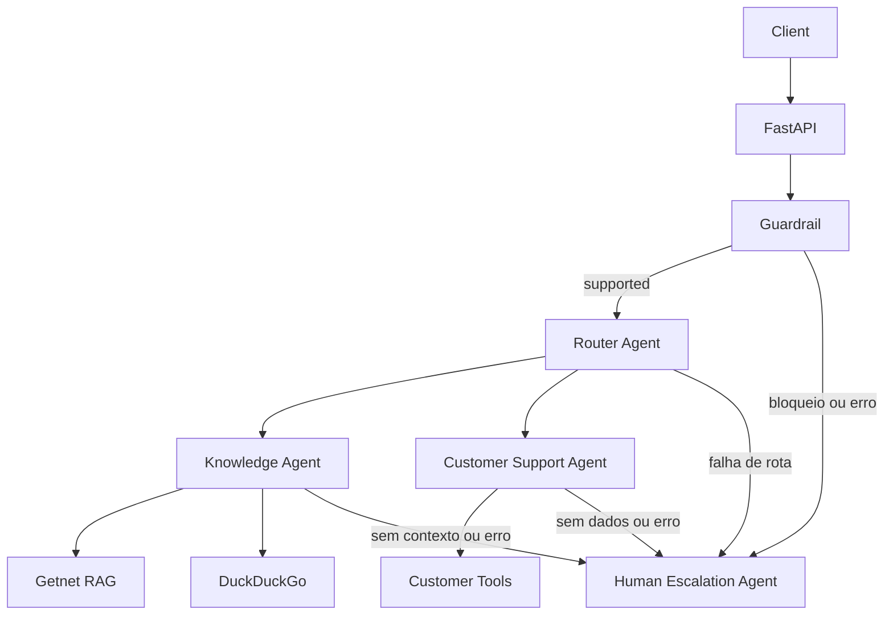

# AI Hardcore Engineer — Multi-Agent Support System

API de suporte em Python 3.12 com FastAPI, Gemini, RAG local e dados fictícios de clientes. Quatro agentes se comunicam por funções Python, sem filas ou bancos externos.

## 1. Configurar

Na raiz do projeto, crie o `.env` se ainda não existir:

```bash
cp -n .env.example .env
```

Preencha a chave e o modelo no `.env`:

```dotenv
GEMINI_API_KEY=sua-chave
GEMINI_MODEL=gemini-3.5-flash-lite
GEMINI_TIMEOUT_SECONDS=30
HTTP_TIMEOUT_SECONDS=15
```

O `.env` é ignorado pelo Git. Use um modelo disponível na sua conta e uma cota gratuita para executar sem custos.

## 2. Executar com Docker

Requer Docker e Compose 2.24 ou superior.

```bash
docker compose up --build -d --force-recreate
docker compose exec api python -m app.rag.ingest
curl -fsS http://localhost:8000/health
```

Esperado: `{"status":"ok"}`. A ingestão prepara o RAG com páginas oficiais brasileiras, incluindo Clássica, Smart e Pix. Repita a ingestão para atualizar os documentos; após alterar código ou `.env`, repita também o primeiro comando.

- API: http://localhost:8000
- Documentação interativa: http://localhost:8000/docs

## 3. Testes automatizados — sem consumir Gemini

```bash
docker compose exec api python -m pytest -q
```

Usam mocks para Gemini, busca web e downloads. Cobrem roteamento, guardrails, escalonamento, RAG, customer tools, API, logs e avaliação.

## 4. Avaliação — aprovação/falha

Com a API rodando e o RAG carregado:

```bash
docker compose exec api python -m evals.run
```

Executa os **15 casos de [evals/cases.json](evals/cases.json)**: os dez cenários originais, perfil do cliente e quatro bloqueios de guardrail. Mostra `PASSED`/`FAILED`, diferenças entre esperado e recebido e o resumo `Total`, `Passed`, `Failed` e `Accuracy`.

Compara rota, guardrail, tools, escalonamento e validade do `request_id`. A comparação de máquinas exige as fontes dos dois produtos; o caso Pix exige a página brasileira de Pix. **Não avalia a precisão factual do texto nem imprime as respostas completas.** Código de saída: `0` para aprovação total, `1` para casos com falha e `2` para arquivo de casos inválido.

Usa Gemini real e busca externa, consumindo a cota. A pausa padrão de 15 segundos entre casos reduz erros 429; a execução leva alguns minutos. Para aumentar a pausa:

```bash
docker compose exec api python -m evals.run --delay 20
```

## 5. Teste manual — respostas completas

Para uma pergunta, use `/docs` ou `curl`:

```bash
curl -sS http://localhost:8000/chat \
  -H 'Content-Type: application/json' \
  -d '{"message":"When will my recent sales be deposited?","user_id":"cliente1988"}'
```

Para imprimir o JSON completo dos **mesmos 15 cenários**, incluindo `answer`, `sources` e metadados, execute este bloco. Ele também usa Gemini real e aguarda 15 segundos entre casos:

```bash
docker compose exec -T api python - <<'PY'
import json
import time
from pathlib import Path

import httpx

casos = json.loads(Path("evals/cases.json").read_text(encoding="utf-8"))

with httpx.Client(timeout=150) as client:
    for numero, caso in enumerate(casos, start=1):
        if numero > 1:
            time.sleep(15)
        print(f"\n{'=' * 60}", flush=True)
        print(f"Caso {numero}: {caso['name']}", flush=True)
        print(f"Rota esperada: {caso['expected_route']}", flush=True)
        print(caso["message"], flush=True)
        try:
            resposta = client.post(
                "http://localhost:8000/chat",
                json={"message": caso["message"], "user_id": caso["user_id"]},
            )
            print(f"HTTP {resposta.status_code}", flush=True)
            print(json.dumps(resposta.json(), ensure_ascii=False, indent=2), flush=True)
        except (httpx.HTTPError, ValueError) as erro:
            print(f"Falha: {erro}", flush=True)
PY
```

O modo manual serve para ler as respostas; ele não calcula aprovação ou métricas.

## Como interpretar a resposta

| Campo | Significado |
| --- | --- |
| `answer` | Resposta gerada ou mensagem fixa de escalonamento |
| `status` | `answered` ou `escalated` |
| `route` / `guardrail_category` | Decisões tomadas, quando disponíveis |
| `agents_used` / `tools_used` | Agentes executados e tools tentadas |
| `sources` | URLs fornecidas como contexto, sem garantia de cobertura completa |
| `request_id` | UUID para localizar a requisição nos logs; também no header `X-Request-ID` |
| `escalation_reason` | Motivo padronizado, presente somente no escalonamento |

HTTP `200` indica processamento concluído; confira `status` para identificar escalonamento. Cliente inexistente retorna `404`, entrada inválida retorna `422` e falha inesperada retorna `500`.

**O escalonamento é simulado:** nenhum operador é contatado e nenhum ticket é criado. No Knowledge, o Gemini deve declarar que o contexto permite responder; caso contrário, retorna `escalated` com `insufficient_information`. Essa declaração não substitui a revisão factual.

## Arquitetura



- **Guardrail:** Gemini classifica `supported`, `irrelevant`, `sensitive` ou `unsafe` antes do Router. Categorias bloqueadas e decisões inválidas não chegam às tools.
- **Router:** valida JSON do Gemini e escolhe `knowledge_getnet`, `knowledge_web` ou `customer_support`.
- **Knowledge:** usa RAG para Getnet ou até cinco snippets DuckDuckGo para perguntas externas. Escalona se não houver resultados ou se o modelo declarar contexto insuficiente.
- **Customer Support:** seleciona `get_customer_profile` e/ou `get_customer_activity`. Consulta `data/customers.json`; `cliente1988` possui dados fictícios com snapshot fixo em 15/10/2026.
- **Human Escalation:** responde deterministicamente a bloqueios, falta de contexto e falhas, sem chamar Gemini.

Pipeline RAG: **HTML → BeautifulSoup → chunks de até 180 palavras, sobreposição de 30 → TF-IDF → cosine similarity → até 4 trechos → Gemini**. Prioriza `site.getnet.com.br`: máquinas, Pix, crediário, Link de Pagamento, Get Conta e antecipação. Mantém as páginas globais `getnet.net` como fontes adicionais. Tenta até 12 URLs (máximo configurável de 20) e salva em `data/rag/chunks.json`.

Extrai também os textos literais das fichas técnicas e FAQs embutidas nos widgets, sem executar JavaScript, e mantém essas seções separadas das ofertas. Expande termos comuns de inglês para português; comparações preservam fontes dos dois produtos. O retrieval é local; a geração depende do Gemini. Falha total na ingestão preserva a base anterior.

O código fica em `app/agents`, `app/guardrails`, `app/rag` e `app/tools`. Toda chamada ao LLM passa por `app/services/gemini.py`. Não há banco vetorial, embeddings pagos ou framework de agentes.

## Logs e diagnóstico

```bash
docker compose logs -f api
```

Eventos JSON registram recebimento, guardrail, rota, tools, retrieval, escalonamento e conclusão, correlacionados por `request_id`. Usam apenas `logging`, sem serviço externo, e não incluem chave, mensagem ou dados privados do cliente. Os logs do Uvicorn mantêm o formato padrão.

Falhas externas viram escalonamento controlado. Consulte o código e a etapa no evento `request_failed`:

| Código no log | O que verificar |
| --- | --- |
| `429` | Cota/limite no Google AI Studio; aumente `--delay` ou a pausa manual se for limite de frequência |
| `503` | Chave ausente, modelo indisponível ou base local inválida; confira a etapa |
| `502` | Chave, permissões, modelo, parâmetros ou conectividade |
| `504` | Timeout do Gemini |

`/health` confirma somente que a API responde. Os testes com mocks também não comprovam disponibilidade do Gemini.

## Executar sem Docker

Com Python 3.12 e o `.env` configurado:

```bash
python3.12 -m venv .venv
source .venv/bin/activate
pip install -r requirements.txt
python -m app.rag.ingest
uvicorn app.main:app --host 0.0.0.0 --port 8000
```

Em outro terminal, com o ambiente ativado, use `python -m pytest -q` ou `python -m evals.run`. O teste manual pode ser feito em `/docs` ou com o `curl` acima.

## Limitações

- RAG limitado às páginas coletadas e coincidência de termos, com expansão bilíngue simples; pode faltar documentação específica. Não renderiza JavaScript. Snippets web podem estar desatualizados.
- Classificação e redação dependem do Gemini; aprovação na avaliação não garante precisão factual ou consistência de idioma.
- Dados de clientes são fictícios e não se atualizam automaticamente. O guardrail não substitui autenticação; esta demonstração não possui autenticação.
- Fluxo síncrono: até três chamadas Gemini para conhecimento e quatro para suporte. Quotas e indisponibilidade externas podem afetar os testes reais.

Para encerrar o Docker:

```bash
docker compose down
```
